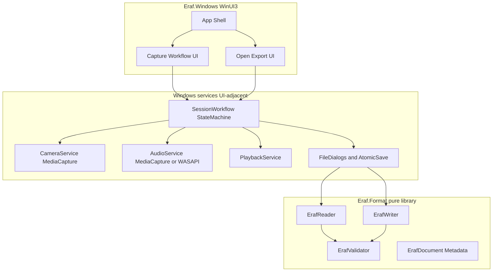

# ERAF Initial Audit Report and Windows Phase 1 Plan

**Status:** Audit and design only. **No application implementation authorized** until this plan is explicitly approved for execution.
**Phase 2 (Android):** Explicitly deferred until the Windows release gate passes and Phase 2 is explicitly approved.

Approved constraints (2026-10-23):

- **Windows:** .NET 8 + WinUI 3
- **Android (later):** Kotlin + Jetpack Compose
- **Format libraries:** Separate native implementations governed by one normative spec + shared golden fixtures
- **Container:** Design A — documented binary container (not ZIP)
- No MAUI / Flutter / React Native solely to share format code

---

## 1. Repository overview (greenfield findings)

| Finding | Evidence |
|---|---|
| Empty workspace | `C:\My Projects\Eraf` contains **0 files** at audit time |
| Not a git repository | No `.git` directory |
| No existing app, media, or format code | Nothing to reuse or preserve |
| New project, not an extension | All structure must be created from scratch |

**Verified on this machine (2026-10-23):**

- .NET SDK **8.0.426** present
- OS: Windows **10.0.26300** (win-x64)
- Windows App Runtime packages present (1.1–1.8 and 2.x runtimes installed)
- OpenJDK **17** present (relevant only for Phase 2)

**Not verified / missing (blockers or assumptions before first build):**

- Visual Studio Installer / `vswhere` **not found** at the standard path
- No .NET workloads installed (`dotnet workload list` empty)
- WinUI / Windows App SDK project templates **not installed** (`dotnet new list` has no WinUI entries)
- No `Microsoft.WindowsAppSDK` NuGet packs cached locally
- Developer Mode: **not checked**
- Camera and microphone hardware: **not checked**
- `ANDROID_HOME` / `ANDROID_SDK_ROOT`: **unset** (Phase 2 only)

**Implication:** Milestone 0 must install WinUI tooling and prove a blank packaged WinUI 3 app builds before feature work. Do not treat WinUI as available until that smoke build succeeds.

---

## 2. Current architecture diagram

There is no current application architecture. Target Phase 1 architecture:



---

## 3. Proposed solution and project structure

```text
Eraf/
  docs/
    ERAF_FORMAT_SPEC.md      # normative format authority
    ARCHITECTURE.md
    IMPLEMENTATION_PLAN.md   # this document
    TESTING.md
    SECURITY.md
    DECISIONS.md
    STATUS.md
    USER_GUIDE.md            # late Phase 1
  fixtures/eraf/             # golden vectors handcrafted + generator output
  src/
    Eraf.Format/             # net8.0 class library, no WinRT/UI refs
    Eraf.Windows/            # WinUI 3 packaged desktop app (.NET 8)
  tests/
    Eraf.Format.Tests/       # xUnit; all format/negative/interop vectors
  tools/
    Eraf.FixtureGen/         # optional tiny console to emit golden files
  README.md
  Eraf.sln
```

**Module responsibilities**

- `Eraf.Format`: serialize/parse/validate ERAF; media-type enums; size limits; hashes; no camera/audio/UI
- `Eraf.Windows`: shell, workflow state machine, MediaCapture camera, audio record/playback, file pickers, atomic save, accessibility
- `Eraf.Format.Tests` + `fixtures/eraf`: conformance and negative tests; Android will later consume the same fixtures

**Existing functionality reusable:** none.

---

## 4. Windows architecture and dependency choices

### Approved stack

- .NET 8 + WinUI 3 (Windows App SDK), packaged MSIX-style WinUI app for camera/mic capability declarations
- Format library: `net8.0` (not `net8.0-windows`) so it stays UI-free
- Tests: xUnit + FluentAssertions (or built-in asserts only if keeping deps minimal)

### Planned NuGet / tooling (to verify at Milestone 0)

- `Microsoft.WindowsAppSDK` (pin a stable 1.6+ or 1.7/1.8 line compatible with .NET 8 after smoke build)
- WinUI templates via `dotnet new install Microsoft.WindowsAppSDK.WinUI.CSharp.Templates` **or** Visual Studio WinUI workload
- Optional later: `CommunityToolkit.Mvvm` only if it reduces boilerplate without obscuring the workflow state machine

### Media APIs (evaluate in Milestone 3–4; fallbacks required)

- **Camera:** `Windows.Media.Capture.MediaCapture` + preview `CaptureElement`; photo via `MediaCapture.CapturePhotoToStorageFileAsync` or frame grab to JPEG bytes without recompressing when already JPEG
- **Import fallback:** `FileOpenPicker` for `.jpg`/`.jpeg` (mandatory path when camera absent or permission denied)
- **Recording:** Prefer `MediaCapture` with `MediaEncodingProfile.CreateM4a(...)` for AAC-LC in `.m4a`; if concurrent camera+mic session proves unreliable after photo freeze, tear down preview and record audio on a dedicated capture session while retaining JPEG bytes in memory/temp
- **Playback:** `MediaPlayer` / `MediaPlayerElement` for m4a inside ERAF (extracted to temp for playback, then cleaned up)
- **Do not claim** pause/resume until verified on target MediaCapture profile; if unsupported, expose stop/retry only and document the limitation

### State machine (session-scoped, not global singleton dump)

`Idle → CapturingPhoto → PhotoPreview → RecordingAudio → AudioPreview → ReadyToSave → Saving → Saved | Error`

Plus explicit `Cancel`/`Discard` edges that clean temp media and never mark incomplete audio as saved.

---

## 5. ERAF binary format sketch (Design A — approved)

Normative detail will live in `docs/ERAF_FORMAT_SPEC.md`. Sketch for v1:

### Layout

1. Fixed header (**64 bytes**, little-endian)
2. Optional integrity block (0, 32, or 64 bytes depending on flags)
3. Image payload (raw JPEG bytes)
4. Audio payload (raw M4A/AAC bytes)

```text
Offset  Size  Type     Field
0       4     bytes    Magic = 0x45 0x52 0x41 0x46 ("ERAF")
4       2     u16      FormatVersion = 1
6       2     u16      HeaderLength = 64
8       2     u16      Flags
                         bit0 = ImageSha256 present
                         bit1 = AudioSha256 present
                         bits2-15 = reserved, must be 0 on write; unknown bits => reject in v1
10      2     u16      Reserved0 = 0 (reject if nonzero in v1)
12      2     u16      ImageMediaType  (1 = image/jpeg)
14      2     u16      AudioMediaType  (1 = audio/mp4)
16      2     u16      AudioCodec      (1 = AAC-LC / mp4a.40.2)
18      2     u16      Reserved1 = 0
20      8     u64      ImagePayloadLength
28      8     u64      AudioPayloadLength
36      8     u64      AudioDurationMs   (0 = unknown/unset)
44      8     u64      CreatedUtcUnixMs  (0 = unknown/unset)
52      4     u32      HeaderChecksumCRC32  (CRC-32 of bytes 0..51)
56      8     bytes    Reserved2 = 0

[If Flags.bit0] 32 bytes ImageSha256
[If Flags.bit1] 32 bytes AudioSha256
[ImagePayloadLength bytes] JPEG
[AudioPayloadLength bytes] M4A
```

### Rules

- Byte order: little-endian for all multi-byte integers
- Serialize with explicit binary writers; **do not** `sizeof` unmanaged structs as the wire format
- `totalSize = HeaderLength + hashBlockSize + ImagePayloadLength + AudioPayloadLength` must equal file length exactly
- Overflow-safe checked arithmetic before any allocation
- Reject: wrong magic, version != 1, HeaderLength != 64 (for v1), nonzero reserved, unknown flag bits, zero image/audio lengths, lengths that overrun file, CRC mismatch, SHA-256 mismatch when present, unsupported media/codec IDs
- Unsupported version: fail with clear `UnsupportedVersion` error; do not partially open
- Unknown optional fields: none in v1 beyond flagged hashes; future versions may grow `HeaderLength` only on version bump
- Hashes detect accidental corruption only — not authentication
- Atomic save: write `name.eraf.partial` (or unique temp beside target) → flush → `File.Replace` / move into place; on failure leave original intact

### Resource limits (v1 defaults; configurable constants in format library)

- Max total file: **256 MiB**
- Max image payload: **64 MiB**
- Max audio payload: **64 MiB**
- Max recording duration: **10 minutes** (enforced by recorder, reflected in duration field when known)

### Privacy

- No GPS, device IDs, contacts, or path metadata in the container
- Preserve JPEG/M4A bytes as captured; do not strip/re-encode unless a future approved requirement says otherwise

---

## 6. Audio codec recommendation

**v1 mandatory audio:** AAC-LC in an MPEG-4 / `.m4a` bitstream  
**Identifiers:** `AudioMediaType=1` (`audio/mp4`), `AudioCodec=1` (`mp4a.40.2`)

**Windows rationale:** `MediaEncodingProfile.CreateM4a` is the well-supported MediaCapture recording path; playback via `MediaPlayer` is reliable; avoids shipping native Opus encoders on Windows for v1.

**Android foreshadowing (not implementing now):** `MediaRecorder` MPEG-4 + AAC is the matching pair for interoperability.

**Rejected for v1 as primary:** Opus (extra native deps / uneven MediaCapture support), raw WAV (size), platform-specific containers without a shared media-type story.

**Image:** JPEG only in v1 (`ImageMediaType=1`). Import non-JPEG → convert once to JPEG on import **or** reject with a clear message; preference is convert-on-import for UX, documented in DECISIONS.

---

## 7. Workflows, errors, permissions, security

### Flow A / B (unified after shutter)

1. Capture or import JPEG → hold bytes + temp preview path in session
2. Preview photo → Record / Skip-not-allowed (audio required for v1 save)
3. Record → stop → preview audio → retry / discard / accept
4. Save `.eraf` via format writer + atomic replace
5. Open `.eraf` → validate → show image → play audio → export image/audio as original payloads

Camera preview and mic recording need not be simultaneous; after photo, freeze session image and record audio afterward if APIs conflict.

### Permissions / capability failures

- Declare webcam + microphone in app manifest
- On denial or missing device: show actionable error; keep **image import** path available
- Never save empty/partial audio as success
- Unsaved-work prompt on close/navigate

### Security (untrusted `.eraf`)

- Strict validation before decode/playback
- Size caps; no unbounded allocations from claimed lengths
- Temp files under app-controlled directories with restrictive ACLs where feasible; delete on cancel/fail/success paths
- No network, telemetry, or embedded-code execution
- Dependency/license inventory in `docs/SECURITY.md`

---

## 8. Incremental Windows milestones

| ID | Milestone | Exit evidence |
|---|---|---|
| M0 | Tooling smoke: templates/WASDK install, blank WinUI app builds/runs | Build log + running empty window |
| M1 | Docs: format spec, architecture, decisions, status; fixture policy | Spec reviewable; no app features yet |
| M2 | `Eraf.Format` reader/writer/validator + unit/negative tests + handcrafted fixtures | All format tests green |
| M3 | Image import + JPEG preview in WinUI; camera capture if hardware allows | Manual + automated where possible |
| M4 | Audio record/playback/retry/discard with duration/size limits | Demo + unit tests for limit enforcement |
| M5 | Session workflow state machine wiring photo+audio | Transition tests |
| M6 | Save/open/export ERAF; atomic replace; overwrite protection | Integration tests |
| M7 | Permissions, errors, malformed-file UX, security hardening | Negative tests + manual permission cases |
| M8 | Accessibility (keyboard, AutomationProperties), UI polish | Checklist + smoke |
| M9 | Full regression + Windows release gate package | Gate checklist signed off |

Android milestones begin only after explicit Phase 2 approval.

---

## 9. Testing strategy

**Unit:** magic/version/header CRC; length bounds; overflow; truncated; wrong reserved/flags; hash mismatch; unsupported media; state transitions; temp cleanup helpers.

**Integration:** assemble JPEG+M4A → write → read → payload byte-identical; atomic save leaves original on failure; export round-trip.

**Negative:** empty file; random bytes; truncated; bad CRC; oversized declared lengths; missing payloads; zero sizes.

**Interop (Phase 1 prep):** check in golden fixtures produced by a small generator **and** at least one hand-edited valid file so writer/reader bugs cannot hide each other. Android will later consume the same `fixtures/eraf`.

**UI:** essential workflow smoke (manual until UI test harness is justified); permission denial scripts documented if automation unavailable.

**Evidence rule:** a milestone is incomplete without commands run and observed results recorded in `docs/STATUS.md`.

---

## 10. Acceptance criteria and release gates

### Windows Phase 1 gate (all required)

1. Documented build succeeds on this machine
2. Capture **or** import photograph
3. Record, review, replace, discard voice note
4. Create and reopen valid `.eraf`
5. Image display + audio playback after reopen
6. Denied mic / unavailable camera handled; import still works
7. Invalid/corrupt ERAF rejected safely
8. Size limits enforced
9. Failed save does not destroy existing file
10. Automated tests cover serialize/parse/validate + key transitions
11. Regression suite green
12. Docs match behavior
13. Supervisor (Cursor) review of source + evidence approved by the product owner

### Assumptions still needing verification before/at M0–M4

1. WinUI templates + Windows App SDK restore/build succeed with .NET 8 on this PC
2. Developer Mode enabled for packaged debug deploy
3. `MediaCapture` M4A recording works on available microphones
4. Camera presence optional; import path mandatory
5. Pause/resume recording may be deferred if API behavior is unreliable

---

## Architectural / security risks (greenfield)

- Tooling gap: WinUI not yet buildable here until M0
- Dual format implementations later (C# + Kotlin) can drift without strict fixtures — mitigate with normative spec + golden vectors first
- MediaCapture lifecycle complexity (preview vs record) — mitigate with photo-then-record session model
- Temp media leakage — mitigate with deterministic cleanup and tests
- Treating CRC/SHA as security — explicitly not; document as corruption detection only

---

## Recommended integration strategy

1. Lock format spec + C# `Eraf.Format` + fixtures first
2. Build Windows UX on top of the library
3. Only after Windows gate: Kotlin format library against the same fixtures, then Android UI

---

## Android plan (deferred outline only)

- Kotlin module `eraf-format` mirroring the spec
- CameraX + MediaRecorder AAC/MPEG-4
- SAF document picker for open/save
- Same limits, validation, and `fixtures/eraf`
- Starts only after explicit Phase 2 approval

---

## Approval gate

First implementation milestone after plan approval is **M0 (tooling smoke)**, then **M1 (format specification documents + fixture policy)** — still no full application feature set until those land under review.
